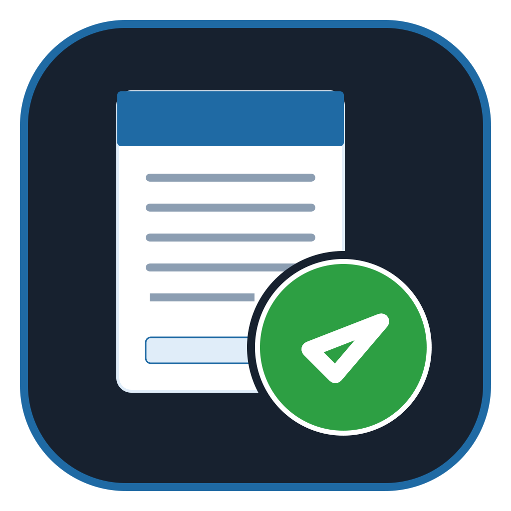

<p align="center">
  
</p>

<h1 align="center">CertiActa</h1>

<p align="center">
  <strong>Sistema Local de Integridad Documental, Estampado Forense y Verificación SHA-256 para Actas Legislativas y Municipales</strong>
</p>

<p align="center">
  
  
  
  
</p>

---

> **Creado por:** **José Moreno** — *Secretario de Cámara del Consejo Legislativo del Estado Bolivariano Delta Amacuro*

**CertiActa** es una aplicación nativa de escritorio de código abierto (*Open Source*) diseñada para dejar atrás la transcripción física manual de los libros de actas, ahorrando decenas de horas de trabajo operativo y generando una fluidez inmediata entre la **sesión**, la **aprobación del acta** y su **verificación mediante medios matemáticos ineludibles (criptografía SHA-256)**, sin requerir conexión a internet ni servidores externos.

📘 **[Descargar / Consultar el Manual de Usuario Oficial (PDF)](docs/Manual_de_Usuario.pdf)** — Guía completa para Diputados/Concejales, Secretarios de Cámara/Operadores y Auditores de Contraloría.

---

## 📋 Principios de Integridad y Arquitectura

1. **Inmutabilidad Absoluta del Escaneo Original:**
   * El PDF escaneado original (ya firmado y sellado) **nunca** se modifica ni sobrescribe.
   * Su huella `SHA-256` se calcula por bloques binarios de 64 KB y se resguarda una copia intacta en `01_Escaneos_Originales/`.

2. **Doble Huella SHA-256 (Original + PDF Generado):**
   * Se genera un nuevo documento en `02_Actas_Con_Hash/{nombre}_CON_HASH.pdf` estampando en todas las páginas un pie de página legible con fondo protector:
     * **Línea 1:** `Sesión: {tipo_sesion} | N.°: {num_sesion} | Fecha: {fecha_sesion} | Pág. {i} de {total}`
     * **Línea 2:** `Esta acta es verificable mediante el siguiente código hash SHA-256 (escaneo original): {sha256}`
   * Además, se calcula y registra el hash exacto del archivo generado (`sha256_con_hash`), permitiendo auditar tanto el escaneo original como el PDF sellado distribuido, tanto dentro de **CertiActa** como con herramientas nativas de Windows (`Get-FileHash` / `certutil`).

3. **Trazabilidad Híbrida con Libro Físico de Respaldo:**
   * Incluye el botón **"Copiar Ficha para Libro Físico"** para asentar de forma rápida y sin errores en el libro físico foliado de Secretaría la sesión, fecha y códigos hash generados.

4. **Persistencia Atómica Local:**
   * Base de datos local en `datos/registro_actas.json` con escritura atómica (`os.replace`) y exportación a Excel (`CSV UTF-8-SIG`).

---

## 📂 Estructura del Repositorio

```text
CertiActa/
├── assets/                   # Logotipo oficial e icono (.png / .ico)
├── docs/
│   └── Manual_de_Usuario.pdf # Manual multi-perfil listo para imprimir o distribuir
├── scripts/
│   ├── generate_assets.py    # Generador vectorial del logotipo e icono
│   └── build_manual_pdf.py   # Generador reproducible del Manual de Usuario en PDF
├── src/
│   ├── config.py             # Configuración central y rutas
│   ├── core/                 # Lógica de dominio (hasher, models, pdf_stamper)
│   ├── repository/           # Persistencia atómica JSON y exportación CSV
│   └── ui/                   # Interfaz gráfica moderna (CustomTkinter)
├── tests/                    # Suite de pruebas unitarias (pytest)
├── main.py                   # Punto de entrada de la aplicación
├── requirements.txt          # Dependencias
├── LICENSE                   # Licencia MIT con Copyright de autoría
└── README.md
```

*(Nota: Las carpetas `01_Escaneos_Originales/`, `02_Actas_Con_Hash/` y `datos/` se crean automáticamente en ejecución local y están excluidas en `.gitignore` para proteger la privacidad institucional de cada Consejo Legislativo).*

---

## 🖥️ Instalación y Uso en Windows

### Opción A: Ejecución desde Código Fuente (Python 3.10+)

1. Clonar o descargar este repositorio:
   ```powershell
   git clone https://github.com/joseamorenoc025/CertiActa.git
   cd CertiActa
   ```
2. Crear y activar entorno virtual (recomendado):
   ```powershell
   python -m venv venv
   .\venv\Scripts\Activate.ps1
   ```
3. Instalar dependencias:
   ```powershell
   pip install -r requirements.txt
   ```
4. Ejecutar **CertiActa**:
   ```powershell
   python main.py
   ```

### Opción B: Compilar Ejecutable Independiente (`.exe`)

Para distribuir en equipos sin Python instalado (o descargar directamente desde **GitHub Releases**):

```powershell
python scripts/build_exe.py
```

Esto genera `dist/CertiActa/CertiActa.exe` y el paquete portátil `dist/CertiActa-v1.2.0-Windows-x64.zip` listo para distribuir.

---

## 🧪 Pruebas Automatizadas

```powershell
python -m pytest tests/ -v
```

---

## 📜 Licencia y Reconocimiento

Distribuido bajo la **Licencia MIT**. Consulta el archivo [LICENSE](LICENSE) para más detalles.

**Copyright (c) 2026 José Moreno — Secretario de Cámara del Consejo Legislativo del Estado Bolivariano Delta Amacuro.**
